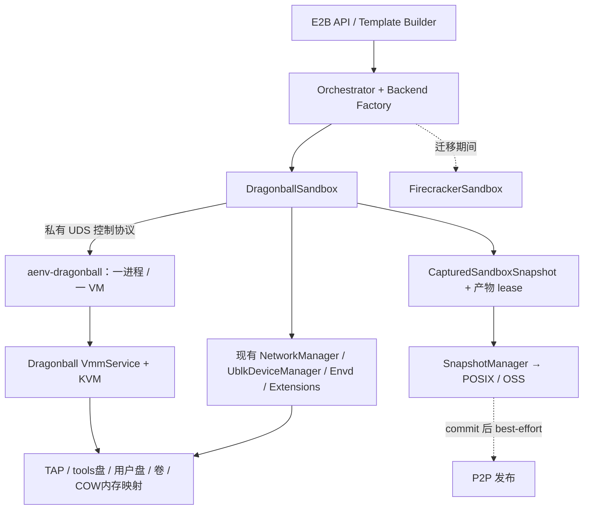

# 使用 Dragonball 替换 Firecracker

状态：用户已于 2026-09-30 确认设计，尚未实现或完成虚拟机实测。

日期：2026-09-29。

实施计划：[M0：Dragonball 接入资格验证](./dragonball-m0-implementation-plan.md)。

AgentENV 基线：`875faeecfbc2c69eed709de06764003b86ac5c28`。

Dragonball 基线：Kata Containers [`cd7051a8dbc0f8e0ac5a63ee4c3884fe8b4ac894`](https://github.com/kata-containers/kata-containers/tree/cd7051a8dbc0f8e0ac5a63ee4c3884fe8b4ac894/src/dragonball)。

## 1. 结论与范围

建议增加 **每个 sandbox 一个独立进程的 `aenv-dragonball` runner**，在该进程中嵌入 Dragonball Rust VMM，通过现有 `SandboxBackend` 接入 AgentENV。保留 envd、网络 namespace、OverlayBD/ublk、快照仓库、卷管理和控制面职责。完成能力与性能验收后，将 Dragonball 切换为默认后端，再退役 Firecracker。

上游已经有 x86_64 checkpoint/restore、设备状态保存和文件映射 COW 恢复，具备接入基础。完整替换仍取决于活跃 I/O 一致性屏障、增量内存采集、ublk 内存恢复、MMDS 替代、卷槽恢复和 balloon 持久化的实现与验证。[上游生命周期实现][db-vm]、[内存实现][db-memory]、[状态格式][db-state]是本设计的事实依据。

用户指定的目标是使用 Dragonball 取代 Firecracker。以下是本提案的设计假设：

- 对外 E2B API 和已有 sandbox 生命周期语义保持兼容。
- 优先降低 AgentENV 与 Firecracker 私有接口的耦合，性能收益通过同条件基准验证。
- 不迁入 Kata runtime、kata-agent、containerd 或 Kata 的镜像管理链路。
- 第一阶段资格范围为 Linux x86_64 + KVM；aarch64 checkpoint 和 PVM 为后续独立资格项。仍依赖这些能力的部署继续使用 Firecracker，不能宣布全平台替换完成。
- 不承诺 Firecracker 与 Dragonball 的内存/设备快照互读；旧模板可以重建，运行中工作负载通过排空迁移。

本次产物仅为设计文档。下文的目录、协议名、配置项和验收阈值属于提案，不代表仓库已有实现。

## 2. 现状与替换边界

现有 [`SandboxBackend`](../../../src/sandbox/backend.rs) 已覆盖冷启动、pause/resume、snapshot、fork、模板 capture、卷冻结/解冻、网络策略和清理。`PausedSandboxState` 是不透明载荷；`CapturedSandboxSnapshot` 持有临时产物所有权直到发布完成。这些边界应继续使用。

但后端隔离尚不完整：

| 现有位置 | 具体耦合 | 本次处理 |
| --- | --- | --- |
| [`src/bin/server.rs`](../../../src/bin/server.rs)、[`orchestrator/service.rs`](../../../src/orchestrator/service.rs) | 装配 `FirecrackerSandboxFactory`，启动/关闭 Firecracker pool | 按节点配置选择后端，保留现有编排状态机 |
| [`sandbox/firecracker/instance.rs`](../../../src/sandbox/firecracker/instance.rs) | REST API、state-only snapshot、`/vm/dirty-memory-ranges` | Dragonball 使用 runner 协议；不仿造整套 Firecracker REST API |
| [`sandbox/firecracker/sandbox.rs`](../../../src/sandbox/firecracker/sandbox.rs) | 磁盘、网络、envd、扩展 hook 与 VMM 调用集中在同一实现 | 提取双方实际共用的资源准备/回滚逻辑，生命周期接口保持一致 |
| [`sandbox/firecracker/overlaybd_snapshot.rs`](../../../src/sandbox/firecracker/overlaybd_snapshot.rs) | OverlayBD writer 接收 Firecracker 生成的 dirty-range 类型 | 引入内部中立内存范围类型，复用 writer 与 seal/restack |
| [`template/runner.rs`](../../../src/template/runner.rs) | 直接创建 Firecracker，另需 `SandboxExecutor` | 模板与普通 sandbox 使用相同 factory；保留 executor 能力 |
| [`snapshot/manager.rs`](../../../src/snapshot/manager.rs)、[`template/builder.rs`](../../../src/template/builder.rs) | startup recording 对 Firecracker capture 类型做 downcast | 改为后端提供 recording 任务及其产物 lease |
| [`sandbox/manifest.rs`](../../../src/sandbox/manifest.rs) | manifest 已有 `backend`，仅允许 Firecracker | 扩展识别与验证，显式保存 Dragonball 恢复约束 |
| [`snapshot/types/version.rs`](../../../src/snapshot/types/version.rs) | `firecracker_version` 与二进制版本探测 | 增加后端身份、构建版本和恢复 ABI；保留旧记录读取 |
| [`orchestrator/persistence/file_backed.rs`](../../../src/orchestrator/persistence/file_backed.rs) | paused record 交由当前 factory 解码 | 在解码前识别后端/版本，异类记录保留且禁止误恢复 |

现有 VM 的设备顺序也属于 guest 契约：`vda` 是只读 tools 根盘，`vdb` 是可写用户镜像，之后是 attached drives 和预留 volume slots。内存恢复使用只读共享 ublk 设备；VMM 私有映射后通过 COW 写入。不能将这些替换成 Dragonball 自带的镜像存储流程。

## 3. Dragonball 能力核实

Context7 用于定位官方资料，关键能力已回到上述固定提交的源码核对。文档中的旧 API 描述可能滞后，例如 x86_64 当前内核加载路径调用 ELF loader，不能只按旧说明选择内核格式。[内核与恢复代码][db-vm]

| 能力 | 固定提交中已确认的行为 | AgentENV 的差距/决定 |
| --- | --- | --- |
| Rust 库接入 | `Vmm`、`VmmService`、`VmmAction`；Kata adapter 用 channel + eventfd 驱动 | 在独立 runner 内复用该接入方式，不依赖 Kata adapter 整个 crate [API][db-api] [adapter][db-adapter] |
| 冷启动 | KVM、CPU/内存配置、块设备与 TAP 网络 | 验证现有 tools/kernel、设备顺序、virtio-mmio 和 IRQ 配置 |
| 暂停/恢复 | `PauseMicroVm`、`ResumeMicroVm` 暂停/恢复 vCPU | 不能把 vCPU 暂停当作所有设备 I/O 已停止 |
| checkpoint | x86_64 `SaveMicrovm`；运行中调用会暂停后恢复；已暂停调用保持暂停 | AgentENV 显式持有 capture 屏障，统一覆盖内存和磁盘 [实现][db-vm] |
| 恢复 | `StartMicroVmFromSnapshot` 重建宿主设备，恢复后直接启动 vCPU | 增加 load-held 阶段，让身份、磁盘、限速完成绑定后才能执行 guest |
| 内存 | 保存所有 RAM region；恢复用 `MAP_PRIVATE` 懒加载，按 region 校验 | 适配块设备容量、增量导出和 memory layout；已有 COW 不等于 ublk 路径可直接用 [实现][db-memory] |
| dirty tracking | address-space builder 有相关开关字段；未见 AgentENV 所需的完整采集接口 | 新增并验证 KVM 写入、设备写入、discard/zero 的统一语义 |
| virtio-blk/net | 有 MMIO 设备与队列状态保存；块设备有独立 I/O 线程 | 为活跃业务增加 drain/hold/ack，验证 pending I/O 为零 [块设备][db-block] |
| 设备重绑定 | 块设备主要按 drive ID 匹配；网卡按 iface ID 匹配；恢复会覆盖保存的 config space | 使用稳定逻辑设备 ID，校验拓扑，单独处理卷容量/只读属性 [块管理][db-block-manager] [设备状态][db-virtio-state] |
| vsock | 不保存活跃连接，要求干净静止点 | envd 继续使用现有 TCP；首版不引入 vsock 控制通道 [实现][db-vsock] |
| balloon / vhost | balloon、virtio-mem 等不在已完成的持久化集合；vhost-net/user-net 无等价 snapshot 路径 | 只启用经恢复认证的设备组合；补齐 balloon 才达到现有内存回收能力 [状态定义][db-state] |
| MMDS / PVM | 本次源码核查未发现 Firecracker MMDS 对等接口或 AgentENV PVM 集成 | MMDS 由 AgentENV 提供兼容服务；PVM 不自动视为支持 |
| 格式兼容 | `FORMAT_EPOCH` 校验；`producer_version` 仅诊断；上游建议同版本消费快照 | AgentENV 额外绑定构建 revision、feature 集合、CPU 与设备 ABI [格式][db-state] |

第一阶段的设备 profile 固定为 virtio-mmio、RawBlock、用户态 virtio-net、串口；关闭 hotplug、VFIO、vhost、virtio-fs、virtio-mem 和不需要的设备。balloon 在完整持久化和 COW 回收验证通过后纳入生产 profile。资格验证阶段关闭 balloon 必须明确标记为能力未齐，不作为最终替换方案。

## 4. 接入方式选择

| 方案 | 优点 | 代价与结论 |
| --- | --- | --- |
| **独立 runner 嵌入 Dragonball（推荐）** | 保留每 VM 的进程故障边界、namespace 和退出回收；Rust API 在 runner 内直接调用 | 增加小型本地控制协议；启动成本可后续通过 warm pool 优化 |
| 在 AgentENV server 中直接嵌入 | 减少控制 IPC 和子进程创建 | VMM panic、进程级 seccomp、内存和资源泄漏影响整个节点；需要重新审查现有隔离与关停模型 |
| 接入 Kata runtime/shim | 可直接利用其 Dragonball 集成 | 引入第二套 sandbox、guest agent、网络和存储生命周期，偏离本次替换范围 |

独立进程仍需权限、文件访问和 seccomp 约束；进程边界本身不构成完整安全隔离。现有 Firecracker 由 AgentENV 直接启动，本设计不假定已经使用 jailer。



## 5. 模块与进程职责

建议新增 `src/sandbox/dragonball/`，实现 `DragonballSandbox`、factory、config、paused state 和 runner client；新增 `crates/dragonball-runner/` 构建 `aenv-dragonball`；仅在客户端和 runner 确需共享协议时增加小型 `crates/vmm-protocol/`。不建立通用 hypervisor 插件框架。

节点进程拥有 sandbox 状态机、网络 slot、卷 reservation、ublk lease、镜像解析、扩展 hook、envd 初始化和仓库发布。runner 拥有 KVM VM/vCPU、设备线程、guest memory、暂停屏障和状态编解码。runner 不访问 OSS/registry 凭证，不负责创建或删除持久卷。

进程启动时进入对应 network namespace，接收经过节点解析的设备路径/FD、工作目录和身份；在 guest 执行前完成资源绑定及 seccomp 设置。控制 UDS 位于私有运行目录，具有受限权限和 peer 校验，不向 guest 或公网暴露。沿用非 root runtime 用户与既有 host setup；新增 syscall、设备访问或内存读取要求进入启动自检，不要求 server 整体长期提权。

停止顺序为禁止新请求、停设备/vCPU、确认进程退出，再释放内存 ublk 引用、磁盘设备和网络 slot。runner 崩溃由节点回收；节点意外退出时 runner 需要父进程退出检测和进程组清理，避免 orphan VM。正常关停继续先持久化为 `Paused`。不能用 `Drop` 代替异步资源清理，也不能在 runner 仍访问设备时归还 pool entry。

### 5.1 控制协议

采用带长度边界和版本的 UDS 请求/响应协议，消息包含 `request_id`、`sandbox_instance_id`、超时预算；同一 VM 的变更操作串行。runner 内将稳定的 AgentENV 消息翻译为上游 `VmmAction`，不直接将上游 Rust enum 当作持久协议。

| 提议操作 | 契约 |
| --- | --- |
| `Hello / Capabilities` | 返回 runner 构建 ID、Dragonball revision、feature profile、协议版本、可读 snapshot ABI |
| `Configure / Start` | 设置经校验的 machine、boot、逻辑设备布局；Start 只启动一次 |
| `LoadHeld` | 重建宿主资源并载入状态；返回时 vCPU 和设备尚未自由运行 |
| `BeginCapture` | 停止 vCPU，完成设备 drain 并冻结，返回 capture token |
| `ExportState / ExportMemoryMap` | 仅在 token 有效时导出同一切点的状态、内存布局与范围 |
| `EndCapture / Resume` | 节点确认所有本地产物完成后释放屏障；同 token 重试可判定结果 |
| `Stop / Status` | Stop 幂等；Status 可核对超时操作的完成状态 |

`LoadHeld`、capture token 和内存范围导出是**待开发扩展**。现有 `StartMicroVmFromSnapshot` 会自动运行 vCPU，不能在其返回后才补写关键配置。

请求超时不代表操作取消。节点以自有任务持有 capture 和资源 lease；若连接丢失且无法确认捕获/恢复状态，应 teardown，不能盲目重发一次 save 或提前恢复 VM。

### 5.2 公共代码提取

按真实复用提取磁盘准备、seal/restack、memory-layer writer 和 network/envd 辅助逻辑。Firecracker adapter 负责将生成模型转换为中立结构；Dragonball 直接生成相同内部结构。初期保留各自 backend 生命周期实现，通过契约测试防止差异扩大。

模板执行需要生命周期与命令执行两种能力，采用组合 trait 或 factory 返回的模板运行句柄，避免为了复用而对 `Box<dyn SandboxBackend>` 做 Firecracker downcast。startup recording 同样通过后端任务工厂返回 recording future 与 lease，不让 `SnapshotManager` 认识 VMM 内部 config。

## 6. 快照、内存与 I/O 一致性

### 6.1 必须具备跨设备 capture 屏障

Dragonball virtio-blk 为队列创建独立线程，存在 pending request map。只在 VMM 主线程调用 save，不能证明工作线程不再写磁盘、guest memory 或 used ring。[块设备实现][db-block]

新增屏障应完成以下顺序：

1. 阻止同实例并发 lifecycle 变更，按现有语义完成 guest 侧 sync；卷独立导出/删除流程继续使用既有 fsfreeze/thaw。
2. 暂停所有 vCPU，阻止设备开始处理新的 guest 请求。
3. 各块设备线程完成已取走的请求、写回状态和 used ring，确认没有 pending I/O；完成底层 flush。未取走的 descriptor 保留给恢复后的设备消费。
4. 停止会写 guest memory 的 net/balloon 等处理路径，等待全部 worker ack；处理或明确定义丢弃临时网络缓冲，不能留下已消费却未完成的队列状态。
5. 在保持同一屏障期间保存 CPU/IRQ/设备状态、导出内存、seal/restack rootfs、attached drives 与卷。
6. 所有本地快照产物可独立引用后释放屏障。完整 snapshot 恢复源 VM 运行；pause/template capture 则继续保持暂停。

磁盘和内存必须属于同一切点。`sync` 或 fsfreeze 不能替代设备 drain，简单 sleep 也不是完成判据。此处提供 VM 级一致性，不承诺自动获得数据库应用级 checkpoint。

### 6.2 分两步建立内存路径

**正确性阶段：**显式暂停并完成 I/O 屏障，复用上游全量 RAM 导出，在本地转换为单个 OverlayBD memory lower。仍输出现有仓库需要的 memory image config，不能引入第二套长期存储格式。此路径用于与增量路径逐字节对照，不作为性能达标的依据。

**生产阶段：**将 state-only capture 和范围导出拆开，复用现有 `ProcessVmReader` 与 OverlayBD writer。拟议的内部描述为：

```text
FrozenMemoryMap {
  capture_token, runner_instance_id, layout_id, page_size,
  regions: [{ guest_base, host_base, image_offset, length }],
  changed_ranges: [...], zero_ranges: [...]
}
```

`host_base` 仅用于节点在 capture 期间读取其子进程内存，不能写入 committed manifest。读取前核对进程身份和 token，读取期间禁止 runner resume/替换映射。现有 `process_vm_readv` 所需的父子关系、UID、ptrace/Yama 和 seccomp 条件需要实机验证；权限不满足时拒绝启用该路径，不静默遗漏页或扩大节点权限。

dirty 集合必须覆盖 KVM vCPU 写入、virtio DMA/used-ring 等用户态写入，以及 balloon/discard 导致的逻辑内容变化。只读取 KVM bitmap 会漏掉设备写入；resident/present 也不是 dirty 的替代品。首个无基底 checkpoint 必须能重建全部 RAM，零页可显式稀疏表示。

首版增量规则选择易验证的方式：每个运行实例保留“自冷启动或最近 load 起”的累计 dirty/zero 集合，每次捕获都覆盖到该固定基底；读取内核 bitmap 后先并入累计集合，普通 capture 成功或失败都不清空累计集合。这样连续多次 snapshot 不会因换错基底丢失先前写入。后续只有在新的基底及其 lease 被原子采用后，才允许引入滚动增量 epoch 优化。

写零以及丢弃/回收造成的可见内容变化必须正确覆盖旧 lower，不能将“本层没有数据”误当成零页。`zero_ranges` 仅表示按当前内存契约已确认为零的区域；其后发生写入时要撤销该页的零标记，不能让累计 zero 集合覆盖更新的数据。测试需要包含祖先页为非零、后代清零后再次写入、失败重试和再次 fork。支持的 host page size、内存 region 数量、GPA hole 与 image offset 规则都纳入 ABI，不能套用 Firecracker 的固定布局常量。

### 6.3 ublk 懒恢复与 COW

保留 `UblkDeviceManager` 对同一内存镜像的只读设备共享与引用计数。Dragonball 将其作为恢复内存源，使用私有 COW 映射；guest 写入不得修改共享 device 或 lower。所有 mapping 退出后才能释放最后一个设备 lease。

上游 `AddressSpaceMgr::restore_state` 以 `file.metadata().len()` 判断镜像长度，而块设备的 `st_size` 通常不代表容量。因此需要新增经验证的内存 backing 描述：普通文件读取文件长度，块设备读取 `BLKGETSIZE64`，并与 manifest 的 virtual size、全部 region 边界相互验证，不能跳过长度校验。[内存源码][db-memory]

还应检查 MAP_PRIVATE 后 region 的 backing 元数据与实际映射一致，明确禁用会预触页的 prealloc/hugetlb 组合，先认证普通页配置。对缺页中断、I/O 错误、SIGBUS、停止中故障及跨进程并发恢复做验证。

### 6.4 balloon、回收与 startup manifest

现有 Firecracker 启用 free page reporting 并配合 DAMON。Dragonball 有 balloon 实现，但缺少对应完整快照状态。补齐 feature/config/queue/activation 持久化，并验证恢复后回收继续生效。上游 balloon 对 file-backed region 可能使用 hole punching；共享只读快照必须禁止这种写入，且 `MADV_DONTNEED` 后重新暴露旧 backing 内容的行为要符合 guest 的 discard 契约，不能简单将回收页都假定为零。[balloon 实现][db-balloon]

DAMON 的监控范围应来自实际 guest memory layout。`startup_pack.rs` 当前通过专用 ublk 内存设备记录 first-touch；抽取后端启动 recording VM 的部分，其余 trace/manifest 和预取逻辑复用。Dragonball 录制失败继续为 best-effort；lease 必须覆盖异步 recording 和上传，不能随主发布 future 提前释放。

## 7. 生命周期语义

| 操作 | Dragonball backend 的成功条件 | 失败处理 |
| --- | --- | --- |
| 冷启动 | 资源配置、扩展 start、元数据就绪、guest 启动、envd init/ready 完成 | 按资源取得顺序反向释放；hook start 失败则启动失败 |
| snapshot | 一致捕获后源 VM 已恢复，返回持有产物 lease 的 capture | 可恢复错误返回前源必须已 Running；无法证明则 Terminal |
| pause | 捕获并持久化同 ID 的 paused state，之后停止 runner 释放运行资源 | 复用现有 persister 的持久化与回滚顺序，不让瞬态内存状态冒充已持久化 |
| resume | 按已记录后端/ABI LoadHeld，重绑定资源和身份后运行同 ID | 保留可重试的 paused 记录；失败实例完全清理 |
| fork | 捕获一次，先恢复源，再并发启动每个 child；每项返回独立结果 | 子实例失败不停止成功兄弟或源；失败 child 的 exclusive 卷回滚 |
| capture_to_dir | guest 保持 held，产物归调用者，模板随后停止 VM | 使用同一 capture 错误分类 |
| snapshot_volumes / 删除冻结 | 保留 VolumeManager、guest fsfreeze、seal、发布与 thaw/stop 顺序 | 恢复性失败必须已解冻；未知状态按终止处理 |
| stop / shutdown | stop 幂等；正常节点关停保存为 Paused | hook stop best-effort；后台清理不随 API 请求取消 |

seal/restack 已改变 live upper、随后 staging 失败时，继续遵守现有保守的 Terminal 分类，不能只因 vCPU 可以 resume 就返回 Recoverable。仓库发布失败与 VMM capture 失败分开：snapshot 已恢复源 VM 后，上传失败不应杀死源，临时产物则按实际 lease 回收。

fork 子实例必须重建独立的 rootfs/可写 attached-drive upper；`exclusive` 卷分别派生，`ro` 卷共享。`volume_snapshots` 与 attached drives 分开持久化，删除源卷不得影响已提交 snapshot。启动时显式 `volumeMounts` 继续覆盖快照中的默认卷恢复行为。

## 8. guest、设备和网络兼容

### 8.1 固定逻辑设备布局

保留 tools `vda`、用户盘 `vdb`、physical extras、volume slots 的顺序，以独立于卷 ID 的逻辑设备 ID 标识每个 slot。保存 machine 配置、MMIO/IRQ 布局、队列数、virtio feature 集合和设备顺序；恢复前比较实际集合，禁止上游位置兜底匹配掩盖错误绑定。

卷槽恢复不能仅把 backing path 指向新 ublk。上游 `VirtioDeviceInfo::restore_state` 会恢复旧 config space，可能带回占位盘容量；新卷的 RO/RW feature 也可能与快照协商值冲突。[设备状态实现][db-virtio-state]

需要专门的 slot restore 扩展：保持逻辑 slot、transport、队列和协商 feature 的合法性，在放行 guest 前更新允许变化的容量并发出 guest 可处理的配置变更；只读性必须由实际打开权限和后端写拒绝强制执行。验证占位盘→真实卷、容量变化及 RO/RW 组合。若现有 guest/profile 无法正确处理，资格验证即失败，不能通过忽略 feature mismatch 或强行改 JSON 绕过。

磁盘限速在 fresh start 和 resume 放行 I/O 之前生效，按当前配置重建；禁用限速时必须清除继承的限制。tools drive 使用捕获时记录的版本，不自动使用本机最新版本。

### 8.2 MMDS 替代与 envd

继续使用现有 envd TCP/HTTP/gRPC 客户端。`thirdparty/envd` 是客户端，不包含 guest envd 服务源码，因此元数据兼容需要用实际打包的 envd/tools 镜像验证，不能通过改客户端字段假定完成。

推荐在 `NetworkManager` 管理的每个 namespace 中增加 metadata listener，提供 guest 当前依赖的 MMDS v2 token 和数据读取行为，保留 `instanceID`、`envID`、`address`、`accessTokenHash`、`imageConfigs` 和受保护字段合并规则。服务地址沿用 guest 的元数据地址；路由、ARP 和端口绑定由 namespace setup 明确配置。

该流量在通用 HTTP egress proxy 重定向之前被 namespace 内部规则截获，并仅允许来自本 sandbox 的 TAP。服务端以 socket/namespace 绑定的 `sandbox_instance_id` 选择数据，不能信任 guest 上送的 sandbox ID。即使 egress deny-all，guest 仍能读取自己的元数据；不能访问邻居元数据或真实云实例元数据。

在放行 vCPU 前写入本实例元数据；fork 使用新身份和 access-token hash，resume 保留原身份。随后复用 envd init 的 token、时间同步、环境、工作目录和用户设置；验证新 token 生效、父 token 在 child 上失败后再标记 ready。节点数据面在此之前保持受控，不暴露恢复瞬间携带的旧鉴权状态。MMDS token TTL、缓存、错误响应和失效重取行为列入协议验收。

### 8.3 内核、CPU 与扩展

用现有 kernel/tools 镜像测试 ELF 加载、串口、init、根盘、virtio-mmio 标准中断、网卡名和 mount 参数；不能要求业务 OCI 镜像了解 VMM 差异。若需要 guest kernel 配置变更，发布新的依赖版本并按后端/profile 选择，不能覆盖旧 Firecracker 使用的依赖。

现有 `cpu-template-helper` 产生 Firecracker CPU JSON，不能直接传给 Dragonball。第一阶段只允许经认证的同质 CPU 池，保存 guest 可见 CPUID/MSR/XSAVE 约束并在恢复前验证；后续将集群 CPU policy 转换为 Dragonball 的实际 vCPU 设置。含不支持 CPU policy 的配置应启动时报错，不能静默忽略。

扩展 start/patch 失败仍使操作失败；stop best-effort。每次 runner 生命周期对应独立 `sandboxInstanceId`，patch 原样转发并存储返回的完整 params；snapshot/resume 保留既有语义，模板构建继续遵守其现有不传播用户扩展配置的规则。

## 9. 持久化与兼容契约

### 9.1 区分 VMM、虚拟化模式与恢复 ABI

`hypervisor_backend = firecracker | dragonball` 与现有 `virtualization_mode = kvm | pvm` 是不同维度。第一阶段 `dragonball + pvm`、非认证架构或设备组合在创建资源之前被拒绝。

提议为 committed record、manifest 和 paused envelope 增加一致的恢复身份：

```text
backend, architecture, virtualization_mode,
runner_build_id, dragonball_revision, snapshot_format_epoch,
restore_abi_id, cpu_policy_id, device_profile_id, memory_layout_id,
kernel_version, tools_drive_version, envd_version
```

其中版本信息用于诊断；`restore_abi_id` 对应有测试证据的兼容集合，不能直接等于 crate version 或仅检查 `FORMAT_EPOCH`。默认只读相同构建/profile，兼容旧构建需要显式加入经过回归认证的 reader 集合。恢复不一定重新加载 kernel，但其版本仍是 guest 状态来源的一部分。

### 9.2 使用现有仓库布局

复用当前 manifest 的 vm state、memory、rootfs 和 attached-drive 层描述；Dragonball 的 `vm_state.bin` 可以是带版本的 JSON envelope，包含上游 `MicrovmState`、重建 machine 所需配置及逻辑设备布局。后缀不决定编码，由 `backend` 与 envelope version 决定。恢复时临时展开为 runner 使用的本地输入。

本次不为改名字迁移所有对象：历史路径 `firecracker-manifest.json` 暂作为共用 manifest 的兼容存储键，在代码中集中封装，必须读取内容中的 backend，不能从文件名推断 VMM。这样 POSIX/OSS/P2P 固定对象布局保持稳定。

上游设备 state 含宿主配置路径；发布 Dragonball envelope 前将路径转换为逻辑设备引用，恢复时由 resolver 注入当前节点路径。持久化数据不包含 PID、host virtual address、tap/netns 运行路径、`/dev/ublkbN` 或 node-local cache 路径。旧 snapshot 的宿主路径处理不在此顺便重写。

旧 Firecracker record 缺少 backend 时，仅在已识别的旧 schema 下解释为 Firecracker；新 Dragonball record 缺必需字段则拒绝。旧 `firecracker_version` 不删除、不填入 Dragonball 版本；新增通用版本字段。record/manifest/envelope 身份不一致、未知后端或超前版本都要在启动前给出明确错误。

### 9.3 所有权与可恢复性

committed repository 继续拥有 durable records/layers；缓存是可重建数据；paused store 独立拥有同 ID 恢复所需数据。capture 和异步 recording 各自持有正确 lease，不能只让 snapshot manager 收到一组裸路径。

paused record 增加可辨识的 backend envelope 和 reader version；不能交给错误 factory 解码后当成损坏记录删除。只要读取到外层元数据，就应保留并标记不可在本节点恢复；提供兼容 runner 后仍可操作。迁移期 Dragonball 与旧后端使用隔离的 paused state 根，回滚旧节点进程不能扫描和 GC 新后端记录。

OSS 继续固定产物 P2P-first、失败回源；POSIX 不从 peers 修复缺失的 committed 文件。只在 repository commit 成功后 best-effort 发布 P2P。GC、共享内存设备引用计数、managed/external layer 和 private registry 凭证策略保持既有所有权边界。

## 10. 配置、构建与依赖维护

拟议配置示例：

```toml
hypervisor_backend = "dragonball"
virtualization_mode = "kvm"

[dragonball]
binary_path = "/opt/agentenv/bin/aenv-dragonball"
work_dir = "/var/lib/agentenv/dragonball-work"
```

默认值在灰度前保持 Firecracker。通用 machine、网络、磁盘限速、boot 参数白名单等当前分散在 `[firecracker]` 的设置应按实际使用迁入公共配置，并提供旧键兼容与冲突校验；不能让 Dragonball 悄悄依赖 Firecracker 专属配置段。pool 后续增加独立 Dragonball 类型，避免消费另一后端/profile 的预热实例。

Dragonball `Cargo.toml` 使用 Kata workspace 依赖和同仓 `kata-sys-util` 等路径依赖，不能只复制 `src/dragonball` 当作完整可独立构建依赖。[依赖清单][db-cargo] 建议在受控 fork 中维护最小补丁队列，以完整 commit 固定 Cargo git 依赖及 lockfile；记录构建 features、补丁版本和依赖清单。CI 验证 AgentENV workspace 的版本约束和 Linux 构建，不预设兼容。

补丁拆为可单独回归/上游化的主题：设备 capture 屏障、held restore、内存 backing/范围导出、balloon persist、卷槽 restore。AgentENV 的 OSS、OverlayBD 仓库和网络策略保持在本项目。切换降低的是对 Firecracker API 的绑定，不意味着上游 Dragonball 能在零补丁下提供全部现有能力。

runner 随 AgentENV 构建/发布，更新依赖下载、checksum、Docker/部署打包、setup-only 和启动自检；过渡期同时保留两种后端资产。追踪 license/NOTICE，避免直接导入整个 Kata runtime 依赖图。

## 11. 迁移与回滚

默认采用**分池灰度**：Dragonball 节点、模板别名和流量入口单独管理；现有 Firecracker 池继续服务其运行实例和快照。当前 scheduler 创建请求 hint 不携带完整快照 ABI，不能把两种节点混入普通轮询并依靠启动失败重试来选择后端。[调度协议](../../../services/api/proto/scheduler.proto)

迁移步骤：

1. 部署能识别新 metadata、但默认仍为 Firecracker 的兼容版本。验证旧 committed/paused 数据可读及异类记录保留。
2. 建立独立 Dragonball KVM 节点池，构建新的 Dragonball 模板 ID/别名。使用原 recipe/OCI 镜像重建；只有数据迁移需要时才导出旧 snapshot 的 rootfs。
3. 用测试租户与可重建负载验证 API、卷、跨节点同 ABI 恢复和性能。旧、新别名不相互覆盖，避免并存期间将 FC 请求解析到 DB 状态。
4. 分批将新建流量切到 Dragonball；旧运行实例自然结束或经用户工作流重建。paused FC 实例必须恢复到 FC 池或被显式迁移/删除，不能以冷启动代替同 ID resume。
5. 满足验收门槛后修改新部署默认后端。记录 Firecracker 依赖的运行实例、paused 记录、模板/snapshot 和 PVM/aarch64 需求，确认归零或有明确保留策略后才能删除实现与资产。

回滚针对**新建流量**：切回旧入口和旧模板，Dragonball 节点继续 drain；已产生的 Dragonball paused state/snapshot 仍需其兼容 runner。不能将回滚描述成“换个配置就能让 FC 恢复 DB 内存”。

若需要同一入口混合调度，作为额外控制面阶段：gateway 在 Schedule 前解析可信的模板/快照后端与 ABI，heartbeat 上报节点支持集合，scheduler 先筛选兼容节点再选址。现有 sandbox 仍走绑定 lookup；assignment/heartbeat 建立绑定，lifecycle event 仍为 best-effort，fork 对每个 child 报告。protobuf 变化同时生成 Go/Rust 并验证两侧。未完成该阶段前采用分池入口，不混池。

## 12. 实施阶段与退出条件

| 阶段 | 交付范围 | 必须通过的门槛 |
| --- | --- | --- |
| M0：可行性验证 | 固定依赖、独立 runner、现有 kernel/tools、块盘/TAP/envd、MMDS 兼容原型 | Linux KVM 冷启动与鉴权；普通文件 full snapshot 恢复；明确 upstream 修改点 |
| M1：运行中一致性 | capture 屏障、held restore、full-memory OverlayBD、卷与 paused 持久化 | 有读写负载的 snapshot/pause/fork；失败恢复、源继续运行、兄弟实例隔离 |
| M2：生产内存与设备 | ublk COW、累计 dirty/zero、balloon、卷槽变更、startup manifest | 与 full dump 对照；共享镜像不变；连续捕获/清零/回收/预取回归 |
| M3：平台集成 | 通用 factory、模板、版本/仓库、配置/依赖、运维指标 | 旧 FC 回归、DB POSIX/OSS、扩展、registry/P2P、节点重启恢复 |
| M4：灰度与默认切换 | 分池、模板重建、性能与故障验证、回滚演练 | 正确性全通过且性能满足预先冻结的指标；旧池有排空方案 |
| M5：退役 | 删除 FC backend/client/pool/资产及过渡配置 | 无仍需 FC 恢复的保留资源；PVM/aarch64 范围得到单独处理 |

M0 通过只说明接入成立。M1–M3 的功能缺口不应通过减少默认 API 能力来掩盖。暂不估算日历工期：主要不确定性集中在设备冻结、balloon/COW 与卷槽 guest 行为，应以 M0/M1 的结果拆分可估算任务。

## 13. 验证与验收

### 13.1 正确性矩阵

现有 [`tests/integration/snapshot.rs`](../../../tests/integration/snapshot.rs)、[`snapshot_attached_drive.rs`](../../../tests/integration/snapshot_attached_drive.rs)、[`posix_startup_pack.rs`](../../../tests/integration/posix_startup_pack.rs)、[`src/orchestrator/tests.rs`](../../../src/orchestrator/tests.rs) 和 [`crates/e2e-tests/`](../../../crates/e2e-tests/) 应转成可对两种后端运行的契约场景；直接测试 Firecracker 私有 API 的测试继续保持后端专属。

| 类别 | 必测场景与判据 |
| --- | --- |
| Capture | CPU 寄存器/内存计数器、活跃异步块 I/O、大于 4 GiB 的多 region、source 持续运行；恢复后数据与队列进度一致 |
| 增量 | CPU 和设备写页、跨 region 范围、非零→零、discard、连续 snapshot、失败后重试；与 held full dump 比较逻辑内存 |
| COW | 多个 child 并发读取同一只读 memory device、分别写同页；父/兄弟/后续新 child 不受影响；最后 lease 才删除 device |
| 设备 | block/net/balloon 的配置、queue/IRQ/feature 恢复；不支持的设备或 CPU profile 明确拒绝；容量/RO 变化正确 |
| 卷 | exclusive fork、ro 共享、uploading/failed 拒绝挂载、挂载中拒删、部分 child 失败回滚、删源卷仍能恢复 snapshot |
| guest / 安全身份 | 冷启动/恢复/fork 的 envd ready、token、USER/workdir/env、metadata TTL；父 token 拒绝、namespace 间不可串读 |
| 生命周期 | 同 ID pause/resume、节点关停/重启、Terminal teardown、Recoverable 已 Running、request cancellation 与重复 Stop |
| 存储与 GC | POSIX/OSS 发布与恢复；repository commit 前故障；recording 延迟；清理 cache 不删 durable/live upper；POSIX 缺失不 P2P 修复 |
| 启动预取 | DB recording 和消费开关、缺失/损坏 manifest 降级、共享设备预取、recording 失败资源回收 |
| 兼容与迁移 | 缺 backend 的旧 FC schema、未知 ABI、record/envelope 冲突、跨后端拒绝、同 ABI 跨节点、分池回滚 |
| 故障注入 | vCPU/设备 ack 超时、ublk 中断、ENOSPC、状态文件截断、runner 崩溃、metadata/扩展失败、进程退出期间资源回收 |

### 13.2 性能指标

使用相同 CPU、kernel/tools、资源规格、rootfs、存储后端与压缩设置，对比当前 FC 基线和 DB。分开测试冷/热页缓存与 pool 开/关，记录并发 1/10/100（受节点容量约束）、至少 1/2/8 GiB 内存及不同 dirty 工作集。不能把上游 Kata 的 agent-ready 数字直接作为 AgentENV 收益。

度量 API 请求至 envd ready 的 p50/p95/p99、capture 停顿、pause/resume、fork 1/N、模板构建、块 I/O、CPU 使用、RSS/PSS、实际读取/上传字节及启动失败率。至少观察低 dirty 与高 dirty 两类负载，防止全量导出退化被均值掩盖。

建议默认切换门槛：所有正确性用例通过；稳定负载下 p95 启动/恢复/fork 和每 VM 内存占用相对基线退化不超过 10%，块吞吐退化不超过 10%；capture 停顿和峰值资源满足现有部署 SLO。10% 是待基准冻结的工程门槛，不是测量结果或性能承诺；变更门槛需记录原因，不能在失败后无说明调整。

### 13.3 检查命令与运行条件

实施时先运行新增 runner/协议/后端的窄测试，再运行仓库的 `make fmt`、`make clippy`、`make test` 与相关 integration/ublk suites。调度协议或 Go 代码改变时增加 `make -C services test`、`make -C services fmt-check vet` 和共享包 `go test ./...`。沿用 Makefile capability runner，并设置独立 `AENV_TEST_STATE_DIR` / `AENV_TEST_DEPS_PATH`。

VM 正确性、ublk、namespace 和性能验证需要非 root 运行的 Linux KVM 测试机及所需 delegated capabilities；当前文档编写未运行这些测试。文档阶段仅核对源码证据、链接、格式与设计一致性。

## 14. 风险与停止条件

| 风险 | 控制方式 | 停止默认切换的条件 |
| --- | --- | --- |
| 模板静止点能力被误当成通用运行中快照 | 显式 worker drain/hold；有负载的重复 capture | 出现漏 I/O、队列卡死、源不能继续运行 |
| RAM 与磁盘取自不同时间 | 同 token 的跨资源屏障；失败分类和注入测试 | 无法证明同一切点或恢复后出现不一致 |
| 上游升级破坏恢复 ABI | 固定 revision/profile，构建身份校验，旧 reader 保留 | 只有 epoch 相同而无跨版本回归证据 |
| 元数据/身份继承错误 | namespace 绑定、vCPU 放行前替换、envd init 后 ready | child 接受父凭证或可读其他实例 metadata |
| ublk / balloon 破坏共享 COW | backing-aware 回收、只读设备、父/兄弟/新 child 验证 | 修改 lower、恢复旧数据违反 guest 语义或 lease 提前释放 |
| 设备槽恢复不兼容 | 稳定拓扑和容量/feature 变更协议 | 卷容量错误、只读失效或 guest 无法正确识别 |
| PVM/aarch64 或历史资源遗漏 | 分开记录支持矩阵和存量依赖 | 仍有 FC-only 资源却计划删掉后端/恢复资产 |

以上风险的主要验证工作在 M0–M2。只有这些条件都有可重复的证据，Dragonball 才能作为现有 Firecracker 后端的完整替代。

## 15. 参考资料

AgentENV 的设计背景见[架构](./architecture.md)、[持久化所有权](./persistence-artifact-inventory.md)、[网络](./networking.md)和[测试清单](./sandbox-testing.md)。行为冲突时以本次固定基线源码为准。

以下 Dragonball 链接全部固定到本次审查提交；重新选取依赖版本时必须重新核对能力表。

- [Dragonball 总览][db-root] 与 [Cargo 依赖/features][db-cargo]。
- [VmmAction API][db-api] 与 [Kata 的 VmmInstance 接入示例][db-adapter]。
- [VM capture/restore 与内核加载][db-vm]、[内存保存/映射][db-memory]、[快照格式及兼容策略][db-state]。
- [块设备线程与状态][db-block]、[块管理器匹配规则][db-block-manager]、[网络管理器持久化][db-net-manager]、[virtio 状态恢复][db-virtio-state]。
- [vsock 的连接限制][db-vsock]、[balloon 的回收处理][db-balloon]。

[db-root]: https://github.com/kata-containers/kata-containers/tree/cd7051a8dbc0f8e0ac5a63ee4c3884fe8b4ac894/src/dragonball
[db-cargo]: https://github.com/kata-containers/kata-containers/blob/cd7051a8dbc0f8e0ac5a63ee4c3884fe8b4ac894/src/dragonball/Cargo.toml
[db-api]: https://github.com/kata-containers/kata-containers/blob/cd7051a8dbc0f8e0ac5a63ee4c3884fe8b4ac894/src/dragonball/src/api/v1/vmm_action.rs
[db-adapter]: https://github.com/kata-containers/kata-containers/blob/cd7051a8dbc0f8e0ac5a63ee4c3884fe8b4ac894/src/runtime-rs/crates/hypervisor/src/dragonball/vmm_instance.rs
[db-vm]: https://github.com/kata-containers/kata-containers/blob/cd7051a8dbc0f8e0ac5a63ee4c3884fe8b4ac894/src/dragonball/src/vm/mod.rs
[db-memory]: https://github.com/kata-containers/kata-containers/blob/cd7051a8dbc0f8e0ac5a63ee4c3884fe8b4ac894/src/dragonball/src/address_space_manager.rs
[db-state]: https://github.com/kata-containers/kata-containers/blob/cd7051a8dbc0f8e0ac5a63ee4c3884fe8b4ac894/src/dragonball/src/snapshot/mod.rs
[db-block]: https://github.com/kata-containers/kata-containers/blob/cd7051a8dbc0f8e0ac5a63ee4c3884fe8b4ac894/src/dragonball/crates/dbs_virtio_devices/src/block/device.rs
[db-block-manager]: https://github.com/kata-containers/kata-containers/blob/cd7051a8dbc0f8e0ac5a63ee4c3884fe8b4ac894/src/dragonball/src/device_manager/blk_dev_mgr.rs
[db-net-manager]: https://github.com/kata-containers/kata-containers/blob/cd7051a8dbc0f8e0ac5a63ee4c3884fe8b4ac894/src/dragonball/src/device_manager/net_dev_mgr.rs
[db-virtio-state]: https://github.com/kata-containers/kata-containers/blob/cd7051a8dbc0f8e0ac5a63ee4c3884fe8b4ac894/src/dragonball/crates/dbs_virtio_devices/src/persist.rs
[db-vsock]: https://github.com/kata-containers/kata-containers/blob/cd7051a8dbc0f8e0ac5a63ee4c3884fe8b4ac894/src/dragonball/crates/dbs_virtio_devices/src/vsock/device.rs
[db-balloon]: https://github.com/kata-containers/kata-containers/blob/cd7051a8dbc0f8e0ac5a63ee4c3884fe8b4ac894/src/dragonball/crates/dbs_virtio_devices/src/balloon.rs
